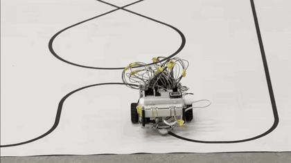

# Raspberry Pi line-following robot

A two-wheel robot I built and programmed for **Cyber-Physical Systems (T-535-CPSY, "Raunkerfi")** at Reykjavík University, fall 2026. The code runs in Python on a Raspberry Pi. Over the semester it went from reading single sensors to driving autonomously: it follows a black line, stops for obstacles, and has a hardware emergency stop.

<p align="center">
  
</p>

## Features

- **Line following** ([`robot/line_follower.py`](robot/line_follower.py)). A TCS34725 colour sensor under the robot measures how dark the floor is. The robot moves in short steps along the edge of the line and switches turning direction each time it leaves the black, so it zig-zags along the line. If it sees only white for 50 readings in a row, it decides the line is lost and stops.
- **Closed-loop speed control** ([`robot/pid_test.py`](robot/pid_test.py)). Encoders on both wheels are calibrated to steps per wheel revolution (626.5 and 655.4, since the two motors aren't identical). A PID controller per wheel corrects the motor power once a second to hold a target speed in rotations per second, so the robot drives straight.
- **Obstacle stop** ([`robot/obstacle_stop_pid.py`](robot/obstacle_stop_pid.py)). PID driving plus an analog IR distance sensor, read through an MCP3008 ADC. The sensor is checked 50 times a second and the robot stops when something gets too close.
- **Emergency stop.** A physical push button, wired as a gpiozero `Button`, stops the motors immediately in every program.
- **Manual driving** ([`robot/keyboard_drive.py`](robot/keyboard_drive.py)). WASD keyboard control over SSH using `curses`.

## Results

The robot completed the full line-following course consistently, taking about **one minute per lap**. That was the fastest setting I found in testing that still kept it on the line every run. Making it faster without losing the line is the main thing I'd improve (see below).

## Hardware

| Part | Used for | Connection |
|---|---|---|
| Raspberry Pi | Runs all the code | — |
| 2 × DC motors with encoders | Driving, speed measurement | Motors: GPIO 12/18 and 19/13 · Encoders: GPIO 23/24 and 6/5 |
| TCS34725 colour sensor | Detecting the line | I²C |
| Analog IR distance sensor + MCP3008 ADC | Obstacle detection | SPI (CE0), ADC channel 0 |
| Push button | Emergency stop | GPIO 26 to GND (internal pull-up) |
| ICM-20948 IMU *(labs)* | Tilt and compass heading | I²C, address 0x68 |
| 2 × LEDs *(labs)* | Level / facing-north indicators | GPIO 17, GPIO 27 |

## Repository layout

```
robot/   final robot programs
  line_follower.py       autonomous line following + IR stop + e-stop
  obstacle_stop_pid.py   PID straight driving + IR obstacle stop + e-stop
  pid_test.py            PID wheel-speed control on its own
  speed_test.py          raw encoder speed readout used for calibration
  keyboard_drive.py      WASD remote control
labs/    earlier sensor labs
  imu_readout.py         ICM-20948 accelerometer / gyro / magnetometer readout
  imu_level_compass.py   level detection and compass heading with hard-iron calibration, shown on LEDs
  mcp3008_adc.py         reading an analog voltage through the MCP3008
media/   demo GIF
```

## Running it

On the Raspberry Pi, with I²C and SPI enabled in `raspi-config`:

```bash
pip install -r requirements.txt
python robot/line_follower.py
```

Press the emergency-stop button or Ctrl+C to stop. Every program stops the motors on exit.

## What I'd improve next

- **Speed.** The line follower moves in tiny stop-and-go steps, which is reliable but slow. Steering continuously, for example with a PID controller on the sensor reading, or with a second colour sensor, would let it drive faster.
- **Faster control loop.** The wheel-speed PID updates only once a second. A shorter loop, plus tuning the I and D terms, would react faster.
- **Shared code.** Combine the PID driving and the line following into one program, so the robot holds a set speed while following the line.

## Acknowledgements

I built and programmed the robot myself, with help from the course teachers when I got stuck. The lab scripts in `labs/` start from Adafruit's example code (MIT licence), as noted at the top of each file.
